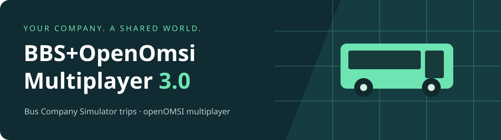

[Português](README.pt-BR.md) · [English](README.md) · [Deutsch](README.de.md) · [Website](https://mayconrib808.github.io/OpenOmsi-BBS/)

# BBS+OpenOmsi Multiplayer 3.0

**Use o multiplayer do openOMSI nas suas viagens do Bus Company Simulator.** O BCS/BBS escolhe a viagem e recebe os dados da condução. O openOMSI simula o mundo compartilhado, para os motoristas no mesmo mapa encontrarem uns aos outros.

> **Candidata de lançamento: 3.0.3.** Esta candidata usa BCS 5.0.2.0 e openOMSI com protocolo 7. O servidor oficial incluído é 0.2.50; o cliente oficial mínimo é 0.2.48. A 0.2.47 não foi publicada oficialmente. Uma viagem completa com dois PCs ainda é a verificação final de jogabilidade.

**[Baixar o ZIP completo para Windows](https://github.com/Mayconrib808/OpenOmsi-BBS/releases/tag/v3.0.3)** · [SHA-256 / source / release notes](https://github.com/Mayconrib808/OpenOmsi-BBS/releases/tag/v3.0.3)

## Começar a jogar

1. Extraia o ZIP inteiro em uma pasta permanente.
2. Feche o BCS, abra Setup.exe e escolha seu idioma.
3. Confira OMSI 2, crie uma sala de empresa ou cole o convite, e salve.
4. Clique em Configurar BCS. No BCS, confira OpenOMSI (Beta) e OpenOMSI-BBS/PeDePeAdapter.
5. Inicie e finalize as viagens pelo BCS. Use a Próxima viagem nativa com o jogo aberto.

[Leia o guia completo de jogador e host](docs/MULTIPLAYER_3.md)

## O que muda na 3.0

- Um convite da empresa encaminha cada viagem para a sessão do mapa. O primeiro motorista de cada mapa hospeda automaticamente; os colegas compartilham aquele mundo.
- Berlin e Carrão City recebem servidores e túneis separados. O link direto do servidor de Berlin aponta apenas para Berlin. Use o convite da empresa para encaminhar por mapa.
- Próxima viagem usa a interface nativa do BCS 5.0.2.0. O Lua original da PeDePe é encaminhado sem alterações; nenhum patch de JAR é aplicado.
- Servidor oficial sem alterações, adaptador de ônibus para protocolo 7, restauração de combustível, game.log novo para o BCS e diagnóstico em ZIP.
- Windows; PT-BR, inglês e alemão; modo solo, backups e atualizações Cloudflare 3.x verificadas.

O PC que hospeda precisa ficar ligado e conectado enquanto os colegas usam o mapa. Ônibus ausentes podem aparecer como substitutos. Mapas e dependências precisam estar instalados pelos jogadores.

## Código, validação e antivírus

O código está incluído e publicado. A compilação usa Go comum, sem empacotadores de executável ou ofuscação, com manifestos SHA-256 e identificação do produto/versão. O executável não possui assinatura Authenticode; não há promessa de zero alertas do VirusTotal sem relatório do hash final.

[Validation](docs/VALIDATION_3.md) · [2.1 → 3.0](docs/FEATURES_2_TO_3.md) · [Antivirus](docs/ANTIVIRUS_3.md) · [Build](docs/BUILD_3.md) · [Issues](https://github.com/Mayconrib808/OpenOmsi-BBS/issues/new/choose)

Discord: **`.zmaycon.`**

Projeto comunitário independente de Mayconrib808. Não é um produto oficial, parceria ou aprovação da PeDePe/openOMSI.

Source: [MIT](LICENSE). Third-party software retains its own license. The ZIP contains the integration source and official openOMSI server; OMSI 2, BCS, vendor plugins, maps, buses, credentials and publisher keys are not redistributed.
